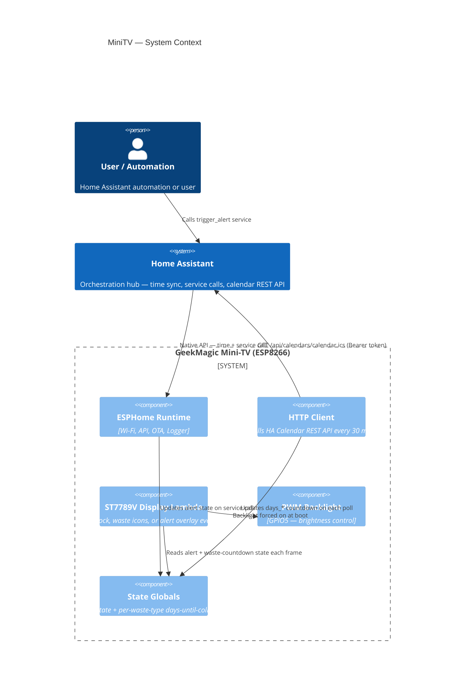
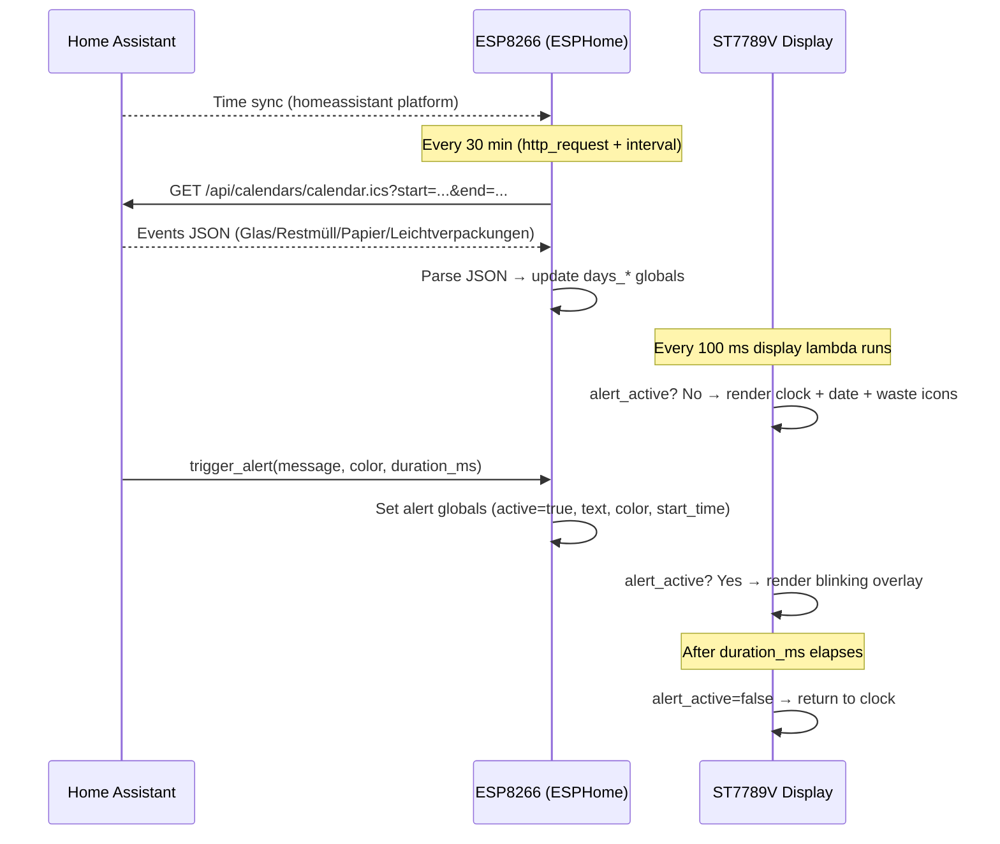
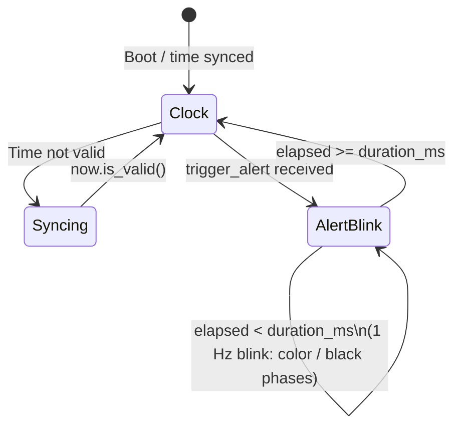
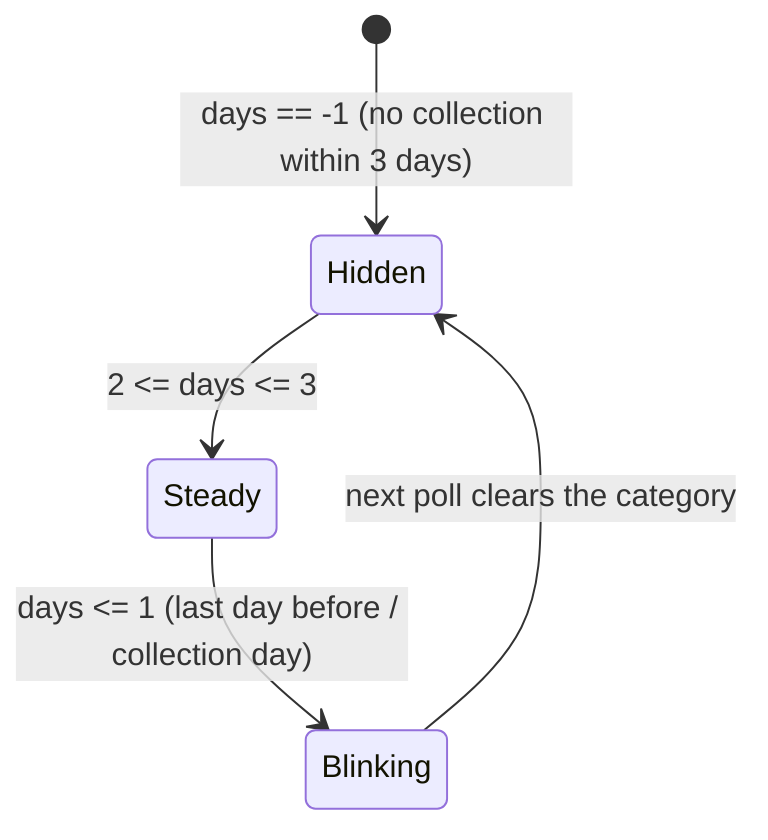

# System Overview

## Architecture

The MiniTV project is an ESP8266-based ESPHome device that displays a clock and can show
push-alert overlays triggered from Home Assistant, plus waste-collection reminder icons
sourced from a Home Assistant calendar.

## Component Responsibilities

| Component | File | Responsibility |
|-----------|------|----------------|
| ESPHome config | `src/minitv/MiniTV.yaml` | Wi-Fi, API, OTA, display, backlight, fonts, alert globals, waste-calendar poll |
| Waste icon asset | `src/minitv/Trashcan.png` | Trash-can glyph, tinted per waste type at draw time |
| Docs | `docs/` | Requirements, masterplan, system overview |
| Repo package | `src/minitv/` | Python package stub for repository tooling |

## Hardware Pin Mapping

| Signal | GPIO | d1_mini label |
|--------|------|---------------|
| SPI CLK | GPIO14 | D5 |
| SPI MOSI | GPIO13 | D7 |
| Display D/C | GPIO0 | D3 |
| Display RESET | GPIO2 | D4 |
| Backlight PWM | GPIO5 | D1 |

## Data Flow

## Alert State Machine

## Waste-Collection Icon Logic

